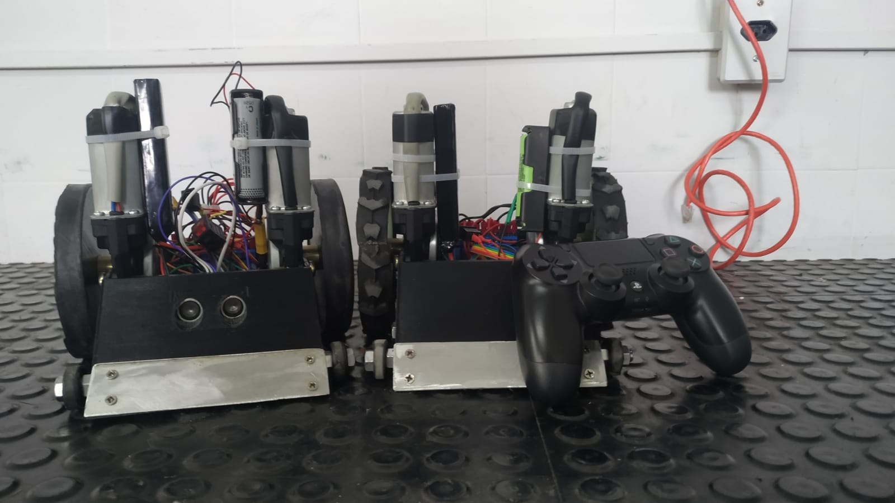
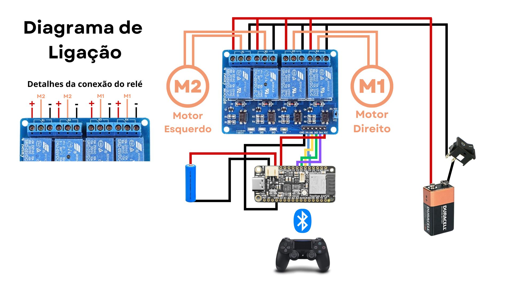

<h1>Robô Modalidade Sumô - Controle Remoto</h1>

  Um robô sumô é um tipo de robô projetado para participar de competições inspiradas no esporte tradicional japonês de sumô. Essas competições envolvem dois robôs tentando empurrar um ao outro para fora de uma arena circular, chamada dohyo, de maneira semelhante aos lutadores de sumô humanos.

  Existem diferentes categorias de robôs sumô, geralmente baseadas em seu peso e tamanho, como micro, mini e mega sumô. Os robôs são frequentemente equipados com sensores, motores e outras tecnologias que permitem a detecção do adversário e estratégias de movimentação para empurrá-lo para fora do dohyo. As competições de robô sumô combinam engenharia, programação e design, desafiando os participantes a criar máquinas autônomas que podem competir de forma eficaz.

  Os robôs podem ser controlados remotamente ou ser totalmente autônomos, dependendo das regras da competição. Em competições de robôs sumô autônomos, os robôs dependem exclusivamente de sua programação e sensores para tomar decisões em tempo real durante a luta.

<h2>Conexão Bluetooth</h2>

  Para criar um robô controlado remotamente, utilizei a ESP32, um microcontrolador com suporte a Bluetooth. A conexão entre o controle remoto e a ESP32 foi estabelecida utilizando um host de Bluetooth chamado BluePad32, que gerencia eficientemente a comunicação Bluetooth entre os dispositivos.

  O funcionamento do robô é baseado nessa conexão. Uma vez estabelecida a comunicação entre o controle remoto e a ESP32, os comandos enviados pelas teclas do controle são transmitidos para a ESP32. Esta, por sua vez, processa esses comandos e executa as operações correspondentes, como movimentar o robô para frente, para trás, virar para os lados ou frear. Dessa forma, o robô responde de maneira precisa e rápida às instruções do controle remoto, permitindo um controle eficaz durante suas operações.

<h2>Integração</h2>

  Para programar a ESP32, vamos utilizar a plataforma Arduino IDE. Siga os passos abaixo para instalar o suporte para a ESP32:
  <ol>
    <li>
      <strong>Baixar e instalar a Arduino IDE:</strong>
      <ul>
        <li>
          Se você ainda não tem a Arduino IDE instalada, baixe-a do <a href="https://www.arduino.cc/en/software">site oficial do Arduino</a> e siga as instruções de instalação para o seu sistema operacional.
        </li>
      </ul>
    </li>
    <li>
      <strong>Abrir a Arduino IDE:</strong>
      <ul>
        <li>Após a instalação, abra a Arduino IDE.</li>
      </ul>
    </li>
    <li>
      <strong>Adicionar suporte para a ESP32:</strong>
      <ul>
        <li>Vá para o menu "File" (Arquivo) e selecione "Preferences" (Preferências).</li>
        <li>Na janela que abrir, procure pelo campo "Additional Boards Manager URLs" (URLs Adicionais do Gerenciador de Placas).</li>
        <li>Adicione a seguinte URL: <strong>https://espressif.github.io/arduino-esp32/package_esp32_index.json</strong></li>
        <li>Clique em "OK" para salvar as mudanças.</li>
      </ul>
    </li>
    <li>
      <strong>Instalar o pacote da ESP32:</strong>
      <ul>
        <li>Vá para o menu "Tools" (Ferramentas) e selecione "Board" (Placa) e depois "Boards Manager" (Gerenciador de Placas).</li>
        <li>Na janela que abrir, digite "ESP32" na barra de busca.</li>
        <li>Encontre o pacote "esp32" da Espressif Systems e clique em "Install" (Instalar).</li>
      </ul>
    </li>
    <li>
      <strong>Adicionar suporte para Bluepad32:</strong>
      <ul>
        <li>Vá para o menu "File" (Arquivo) e selecione "Preferences" (Preferências).</li>
        <li>Na janela que abrir, procure pelo campo "Additional Boards Manager URLs" (URLs Adicionais do Gerenciador de Placas).</li>
        <li>Adicione a seguinte URL: <strong>https://raw.githubusercontent.com/ricardoquesada/esp32-arduino-lib-builder/master/bluepad32_files/package_esp32_bluepad32_index.json</strong></li>
        <li>Clique em "OK" para salvar as mudanças.</li>
      </ul>
    </li>
    <li>
      <strong>Instalar o pacote da ESP32:</strong>
      <ul>
        <li>Vá para o menu "Tools" (Ferramentas) e selecione "Board" (Placa) e depois "Boards Manager" (Gerenciador de Placas).</li>
        <li>Na janela que abrir, digite "esp32_bluepad32" na barra de busca.</li>
        <li>Encontre o pacote "esp32_bluepad32" da Ricardo Quesada e clique em "Install" (Instalar).</li>
      </ul>
    </li>
    <li>
      <strong>Selecionar a placa ESP32:</strong>
      <ul>
        <li>Após a instalação, vá novamente para o menu "Tools" (Ferramentas), selecione "Board" (Placa), vá em "esp32_bluepad32" e escolha o modelo específico da sua placa ESP32 (por exemplo, "ESP32 Dev Module").</li>
        <li>Atenção: escolha a placa dentro de "esp32_bluepad32". Se escolher a placa de mesmo nome dentro de "esp32", a compilação falha com o erro <code>Bluepad32.h: No such file or directory</code>.</li>
      </ul>
    </li>
  </ol>

  Depois de completar esses passos, a Arduino IDE estará configurada para programar a ESP32. Agora você está pronto para começar a desenvolver e carregar códigos para a sua placa ESP32.

<h2>Lista de Materiais</h2>
<table>
  <tr>
    <td>Quantidade</td>
    <td>Componente</td>
  </tr>
  <tr>
    <td>1</td>
    <td>ESP32</td>
  </tr>
  <tr>
    <td>1</td>
    <td>Relé 5V - 4 Canais</td>
  </tr>
  <tr>
    <td>1</td>
    <td>Relé 5V</td>
  </tr>
  <tr>
    <td>2</td>
    <td>Motor Vidro Elétrico</td>
  </tr>
  <tr>
    <td>1</td>
    <td>Bateria 18650</td>
  </tr>
  <tr>
    <td>1</td>
    <td>Bateria Lipo 11.1V (alimentação dos motores)</td>
  </tr>
  <tr>
    <td>1</td>
    <td>Case para bateria 18650</td>
  </tr>
  <tr>
    <td>3</td>
    <td>Conetores XT60(macho+fêmea)</td>
  </tr>
  <tr>
    <td>1</td>
    <td>Controle remoto compatível com o Bluepad</td>
  </tr>
  <tr>
    <td>1</td>
    <td>Barra roscada de 8mm</td>
  </tr>
  <tr>
    <td>2</td>
    <td>rolamento 628 2rs</td>
  </tr>
  <tr>
    <td>2</td>
    <td>Barra de pinos fêmea</td>
  </tr>
  <tr>
    <td>1kg</td>
    <td>Filamento para impressão 3D</td>
  </tr>
</table>

<h2>Placa e controles compatíveis</h2>

  O projeto foi feito para o <strong>ESP32 clássico</strong> (ESP32-WROOM / DevKit V1 / "ESP32 Dev Module", ou a Adafruit Feather ESP32 do diagrama). Ele tem Bluetooth Clássico e Bluetooth LE, então aceita a maioria dos controles suportados pelo Bluepad32, incluindo o DualShock 4 (PS4).

  O <strong>ESP32-S3</strong> e o <strong>ESP32-C3</strong> só têm Bluetooth LE: controles de PS3, PS4, PS5, Switch Pro e Wii não pareiam com eles. Além disso, no ESP32-S3 os GPIOs 27 e 33 usados pelo código não estão disponíveis. A lista completa de controles está na <a href="https://bluepad32.readthedocs.io/en/latest/supported_gamepads/">documentação do Bluepad32</a>.

<h2>Comandos do controle</h2>
<ul>
  <li><strong>D-pad (setas):</strong> frente, trás, giro e diagonais. Ao soltar, o robô para.</li>
  <li><strong>Analógicos:</strong> usados quando nenhuma seta está pressionada. O analógico esquerdo (vertical) controla frente/trás e o direito (horizontal) controla o giro.</li>
  <li><strong>L2:</strong> freio (para os motores).</li>
  <li><strong>R1:</strong> liga/desliga o relé 5.</li>
  <li>Se o controle desconectar, os motores param automaticamente.</li>
</ul>

<h2>Diagrama de Ligação</h2>

<h2>Observações de montagem</h2>
<ul>
  <li><strong>Alimentação dos motores:</strong> use a LiPo 11,1 V da lista de materiais. Motores de vidro elétrico consomem vários ampères, e uma bateria de 9 V (como a do diagrama) não consegue fornecer essa corrente.</li>
  <li><strong>Alimentação do módulo de relés:</strong> o módulo é de 5 V. Se o VCC dele for ligado à bateria 18650 (cerca de 3,7 V), os relés podem falhar. Prefira alimentá-lo com 5 V, por exemplo com um regulador step-down ligado à LiPo, mantendo o GND comum com a ESP32.</li>
  <li><strong>GPIO 12:</strong> é um pino de "strapping" do ESP32. Se a placa não ligar ou ficar reiniciando com o módulo de relés conectado, mude o <code>rele4</code> para o GPIO 26 no código e mova o fio correspondente.</li>
  <li><strong>Depuração:</strong> para ver os dados do controle no Serial Monitor (115200 baud), mude <code>DEBUG_CONTROLE</code> para 1 no código. Deixe em 0 durante as lutas.</li>
</ul>

<h2>Créditos</h2>
<ul>
  <li>Ricardo Quesada: https://github.com/ricardoquesada/bluepad32</li>
  <li>Abraao Lacerda: https://www.youtube.com/watch?v=K_rIaBKQcCk</li>
</ul>
